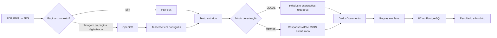

# ValidaDoc

Projeto de mentoria para enviar comprovantes de residência, extrair os campos e conferir regras em Java. Inclui interface em português, upload de PDF/PNG/JPG, OCR real com OpenCV e Tesseract, resultado detalhado e histórico no banco.

O modo padrão usa um extrator local por rótulos e não precisa de chave de IA. Há integração opcional com a OpenAI e perfil PostgreSQL. O código da aplicação fica em [`src`](src).

## Atividade do semestre

**Estado atual: protótipo inicial, em revisão para desenvolvimento acompanhado.** A base foi produzida com assistência de IA e publicada de uma vez; isso não representa várias semanas de trabalho. A versão existente foi preservada na branch [`prototipo-inicial`](https://github.com/n4ndo8/validadoc/tree/prototipo-inicial). O [plano de evolução semanal](docs/EVOLUCAO-SEMANAL.md) organiza a compreensão do código, a revisão com o professor e melhorias que ainda precisam ser realizadas.

Referência: [orientações do professor Kleber Meira](https://github.com/KleberMeira/analise-documento-ia). A publicação inicial reuniu a base funcional já desenvolvida. O incremento seguinte adicionou os endpoints JSON `/api/documentos/exemplo` e `/api/documentos/validar`, com os campos de entrada e saída da referência. As diferenças de implementação e os próximos incrementos estão no [alinhamento da atividade](docs/ALINHAMENTO-ATIVIDADE.md).

## Rodar no Windows

Pré-requisitos: **JDK 17 ou superior** disponível no `PATH`, Windows de 64 bits e internet na primeira preparação para baixar dependências. Não é necessário instalar Node.js ou um servidor web separado.

1. Abra a pasta do projeto e dê dois cliques em **`INICIAR.bat`**.
2. Aguarde a preparação e a inicialização do Java.
3. Abra **http://localhost:8080** no navegador.
4. Mantenha o terminal aberto durante o uso. `Ctrl+C` encerra a aplicação.

Alternativa no PowerShell, dentro da pasta do projeto:

```powershell
.\iniciar.ps1
```

Se o Windows bloquear scripts, o atalho `INICIAR.bat` executa o script com a política ajustada somente para aquele processo. Não é necessário mudar a política global do Windows.

O script chama [`preparar.ps1`](preparar.ps1), que baixa o Maven **3.9.16** e o modelo de idioma português `por.traineddata` para `.tools`, com conferência de checksum. O Maven baixa as bibliotecas Java e nativas de OpenCV/Tesseract. A primeira execução pode demorar; as seguintes reutilizam os downloads.

Para usar outra porta, defina-a antes de iniciar:

```powershell
$env:PORT = '8081'
.\iniciar.ps1
```

Nesse caso, abra `http://localhost:8081`.

## Demonstrar em um minuto

1. Na tela inicial, clique em **Baixar exemplo**.
2. Informe **Ana Silva** no campo **Nome do titular**.
3. Selecione o PDF baixado e clique em **Processar documento**.
4. Confira os campos, as regras avaliadas e o texto extraído.
5. Abra **Meus envios** para consultar o resultado novamente.

O exemplo é fictício, identificado como tal e gerado com a data atual. Para demonstrar uma reprovação, envie o mesmo arquivo informando outro titular. O PDF de exemplo contém texto selecionável: nesse caso a leitura é feita pelo PDFBox. PNG, JPG e páginas digitalizadas usam OpenCV e Tesseract.

Veja o [roteiro de apresentação](docs/APRESENTACAO.md) para explicar as etapas e as decisões do projeto.

## Como o processamento funciona



O PDFBox decide a leitura por página, permitindo PDFs mistos. Nas imagens, OpenCV aplica escala de cinza, redução de ruído e binarização. Tesseract reconhece o texto em português. O extrator transforma esse texto em `nome`, `cpf`, `endereco`, `cidade`, `estado` e `dataEmissao`; campos ausentes ou conflitantes ficam `null`.

No modo `LOCAL`, o documento precisa ter rótulos reconhecíveis, como `Nome:`, `CPF:`, `Endereço:`, `Cidade:`, `Estado:` e `Data de emissão:`. Também há suporte a variações como `Titular:`, `Município:`, `UF:`, `Cidade/UF:` e uma linha `Recife - PE`. As datas locais aceitas são `dd/MM/aaaa` e `aaaa-MM-dd`, com calendário estrito. A data de vencimento não substitui a emissão. Layouts arbitrários e campos sem rótulo não têm interpretação garantida.

## Regras de aprovação

Todas as regras aplicáveis precisam passar. A decisão significa que o documento atende aos critérios deste exercício.

| Regra | Critério |
| --- | --- |
| Tipo de documento | Texto com indicação de comprovante de residência/endereço ou conta de água, energia, telefone, internet ou cartão. É uma heurística textual. |
| Nome | Nome extraído presente e com formato legível. |
| CPF | CPF completo com 11 dígitos. **Não há validação de dígitos verificadores.** |
| Endereço | Endereço e cidade presentes, com uma UF brasileira válida. |
| Emissão | Data válida entre hoje menos 90 dias e hoje, **incluindo os limites**. Datas futuras reprovam. |
| Titularidade | Nome informado obrigatório e igual ao extraído após normalizar acentos, caixa e espaços. Abreviações não são equivalentes. |
| Legibilidade | Texto suficiente e campos extraídos localizáveis no conteúdo lido. |
| Confiança do OCR | Quando houver OCR, a menor confiança média entre as páginas deve ser de pelo menos **60%**. |

A referência mistura “3 meses” e “90 dias”; a implementação usa **90 dias corridos**, configuráveis em `app.validation.max-age-days`. O relógio de negócio usa `America/Fortaleza`.

## Configuração

O padrão é `LOCAL` com H2 em arquivo. [`application.yml`](src/main/resources/application.yml) contém os valores da aplicação. [`.env.example`](.env.example) serve de consulta: o Spring Boot **não carrega esse arquivo automaticamente**. Defina as variáveis no terminal que iniciará a aplicação.

| Variável | Padrão | Uso |
| --- | --- | --- |
| `PORT` | `8080` | Porta HTTP. |
| `SERVER_ADDRESS` | `127.0.0.1` | Endereço de escuta; o projeto é destinado ao uso local. |
| `EXTRACTION_MODE` | `LOCAL` | `LOCAL` ou `OPENAI`. |
| `TESSDATA_PATH` | `./.tools/tessdata` | Pasta que contém `por.traineddata`. |
| `OPENAI_API_KEY` | Vazio | Chave necessária somente no modo `OPENAI`. |
| `OPENAI_MODEL` | `gpt-4o-mini` | Modelo configurado para extração estruturada. |
| `SPRING_PROFILES_ACTIVE` | Sem perfil | Use `postgres` para PostgreSQL. |
| `DATABASE_URL` | `jdbc:postgresql://localhost:5432/validadoc` | Conexão do perfil PostgreSQL. |
| `DATABASE_USER` | `validadoc` | Usuário do perfil PostgreSQL. |
| `DATABASE_PASSWORD` | `validadoc_local` | Senha de desenvolvimento do perfil PostgreSQL. |

### OpenAI opcional

O modo `OPENAI` envia o **texto extraído** à API, inclusive os dados pessoais presentes nele. A chave fica no servidor. A implementação solicita JSON Schema estrito na Responses API e aplica as regras de negócio no Java. O formato estruturado não garante que os valores estejam corretos; por isso os campos ainda são conferidos contra o texto. Consulte a [documentação oficial de Structured Outputs](https://developers.openai.com/api/docs/guides/structured-outputs?api-mode=responses).

Após encerrar a aplicação, execute no PowerShell:

```powershell
$env:EXTRACTION_MODE = 'OPENAI'
$chave = Read-Host 'Chave da API OpenAI' -AsSecureString
$env:OPENAI_API_KEY = [System.Net.NetworkCredential]::new('', $chave).Password
$env:OPENAI_MODEL = 'gpt-4o-mini'
.\iniciar.ps1
```

Esse modo depende de uma chave válida, acesso ao modelo, conexão e disponibilidade de créditos na conta. A integração real com a OpenAI não está incluída na verificação local sem essas credenciais. Falha de API gera um erro explícito; não há aprovação simulada nem troca silenciosa para o modo local.

Para voltar ao extrator sem IA, encerre a aplicação e defina `$env:EXTRACTION_MODE = 'LOCAL'` antes de iniciar novamente. A conferência de evidência do modo IA também reconhece emissão presente no texto em `dd-MM-aaaa`; o extrator local continua limitado aos formatos descritos acima.

### PostgreSQL opcional

É necessário ter Docker com Compose em execução. O arquivo [`compose.yml`](compose.yml) inicia apenas o banco; a aplicação Java continua sendo iniciada pelos scripts.

```powershell
docker compose up -d postgres
$env:SPRING_PROFILES_ACTIVE = 'postgres'
$env:DATABASE_URL = 'jdbc:postgresql://localhost:5432/validadoc'
$env:DATABASE_USER = 'validadoc'
$env:DATABASE_PASSWORD = 'validadoc_local'
.\iniciar.ps1
```

O serviço do banco publica a porta somente em `127.0.0.1` e usa um volume persistente. As credenciais mostradas são exclusivas para desenvolvimento local. Se mudar a senha, use o mesmo valor na inicialização do container e no Java. O perfil PostgreSQL exige verificação no seu ambiente; a execução padrão usa H2.

Para retornar ao H2, encerre a aplicação, remova o perfil desta sessão e inicie outra vez:

```powershell
Remove-Item Env:SPRING_PROFILES_ACTIVE -ErrorAction SilentlyContinue
.\iniciar.ps1
```

## API e código

### Contrato JSON do professor

`GET /api/documentos/exemplo` retorna um payload pronto para enviar a `POST /api/documentos/validar`. A data de emissão da amostra é gerada no dia da consulta.

```powershell
$payload = Invoke-RestMethod 'http://localhost:8080/api/documentos/exemplo'
$json = $payload | ConvertTo-Json
Invoke-RestMethod 'http://localhost:8080/api/documentos/validar' -Method Post -ContentType 'application/json; charset=utf-8' -Body $json
```

O request aceita `nomeArquivo`, `mimeType`, `conteudoDocumento` e `imagemBase64`. Nome e MIME são obrigatórios. Envie texto, Base64 puro de um PDF/PNG/JPG, ou ambos; quando ambos são enviados, o arquivo tem prioridade e o texto é ignorado. Base64 inválido ou arquivo danificado retorna erro, sem substituir silenciosamente a entrada pelo texto. O tipo informado deve corresponder à assinatura do arquivo.

O retorno contém `nomeArquivo`, `etapas`, `dadosExtraidos` e `resultado`. CPF é formatado e cidade inclui a UF quando encontrada, como no exemplo do professor. As etapas deixam explícito quando OpenCV/Tesseract não foram executados (entrada textual ou PDF com camada de texto) e quando a interpretação usou regras locais em vez de IA. Documento reprovado retorna HTTP 200 com pendências; JSON ou entrada inválida retorna HTTP 400.

Esse contrato didático confere presença de nome, CPF, endereço, cidade e emissão até 90 dias, inclusive. Também reprova data futura e confiança OCR abaixo de 60%, quando aplicável. Não exige `nomeEsperado`, não confere titularidade e não exige UF isolada. O endpoint JSON é uma análise sem persistência: não adiciona registros ao histórico da interface. O envio multipart da tela mantém suas regras mais estritas e seu histórico.

Limites: texto de até 50.000 caracteres, nome de até 180 caracteres, arquivo decodificado de até 10 MB, PDF de até 5 páginas e imagem de até 20 milhões de pixels. Não envie prefixo `data:` no Base64.

### Rotas disponíveis

| Método e rota | Função |
| --- | --- |
| `GET /api/config` | Modo de extração e limites da aplicação. |
| `GET /api/documentos/exemplo` | Payload JSON fictício no contrato do professor. |
| `POST /api/documentos/validar` | Valida texto/arquivo Base64 e retorna etapas, campos e resultado. |
| `POST /api/documentos` | Upload `multipart/form-data` com `arquivo` e `nomeEsperado`. |
| `GET /api/documentos` | Lista os 100 resultados mais recentes. |
| `GET /api/documentos/{id}` | Consulta um resultado pelo UUID. |
| `GET /api/exemplo.pdf` | Baixa a amostra fictícia de Ana Silva. |

Exemplo no PowerShell, com o servidor em execução:

```powershell
curl.exe -o comprovante-exemplo.pdf http://localhost:8080/api/exemplo.pdf
curl.exe -F 'arquivo=@comprovante-exemplo.pdf' -F 'nomeEsperado=Ana Silva' http://localhost:8080/api/documentos
```

O retorno inclui status, campos extraídos, regras, avisos, método de extração e texto lido.

```text
src/main/java/br/com/mentoria/validadoc/
  api/          Endpoints e tratamento de erros
  domain/       DadosDocumento, extrator local e regras
  ocr/          PDFBox, OpenCV e Tesseract
  service/      Orquestração, amostra e integração opcional com IA
  persistence/  Entidade e repositório JPA
src/main/resources/
  static/       HTML, CSS e JavaScript da interface
  application.yml
  application-postgres.yml
src/test/java/  Testes automatizados
```

## Verificação

Verificado em 26/10/2026: 74 testes automatizados aprovados, incluindo 12 casos para o contrato JSON do professor e OCR real de imagem Base64. O fluxo original também foi verificado no navegador em desktop e celular, cobrindo PDF aprovado, titular divergente reprovado, PNG lido por OCR, histórico e formato inválido. A integração OpenAI foi testada com um servidor simulado local, sem usar uma chave real.

Para preparar as dependências e executar os testes sem iniciar o servidor:

```powershell
.\preparar.ps1
& '.\.tools\apache-maven-3.9.16\bin\mvn.cmd' verify
```

Também é possível usar `./mvnw` ou `.\mvnw.cmd` com o Maven Wrapper. O modelo de idioma precisa estar preparado para os testes de OCR. `iniciar.ps1 -Testar` executa a verificação e, se ela passar, inicia a aplicação.

Os testes cobrem extração de campos, datas inválidas e ambíguas, fronteira de 90 dias, titular divergente, ausência de nome esperado, evidência dos campos e fluxos de leitura/API. A suíte local não demonstra, por si só, funcionamento com credenciais reais da OpenAI ou com um servidor PostgreSQL externo.

## Limites da entrega

- É um projeto de ensino: **não autentica documentos**, não consulta emissores e não comprova identidade ou residência real.
- Não há autenticação de usuários. O servidor escuta somente em `127.0.0.1` por padrão, para uso no próprio computador.
- Os arquivos originais não são persistidos como documentos. O texto extraído, os campos e os resultados **são armazenados** no banco. No modo H2, os arquivos ficam em `./data`; evite usar documentos pessoais reais em demonstrações.
- O histórico retorna os 100 registros mais recentes. Isso é um limite de consulta, não uma rotina de exclusão dos registros antigos.
- Upload limitado a 10 MB, PDF de até 5 páginas e imagens de até 20 milhões de pixels. Documentos excessivamente longos também são recusados.
- O OCR tem limite de tempo por página e processa um documento por vez. Baixa confiança impede aprovação.
- O pré-processamento melhora contraste e ruído, mas **não implementa correção de rotação ou perspectiva**. Use imagens alinhadas, completas e nítidas.
- CPF mascarado, campos sem rótulos e textos conflitantes podem resultar em campos ausentes e reprovação. O modo IA também pode errar.
- Banco PostgreSQL e serviço real de IA precisam da configuração e validação correspondentes; não são requisitos para demonstrar o modo local.

## Referências oficiais

- [Spring Boot 3.5](https://docs.spring.io/spring-boot/3.5/index.html): configuração e aplicação Java executável.
- [Apache PDFBox 3](https://pdfbox.apache.org/3.0/migration.html): leitura e processamento de PDF.
- [Bytedeco JavaCPP Presets](https://github.com/bytedeco/javacpp-presets): acesso às bibliotecas nativas pelo Java.
- [Tesseract](https://tesseract-ocr.github.io/tessdoc/): OCR e modelos de idioma.
- [OpenAI Responses API](https://developers.openai.com/api/docs/guides/migrate-to-responses) e [Structured Outputs](https://developers.openai.com/api/docs/guides/structured-outputs?api-mode=responses): integração opcional para extração estruturada.
